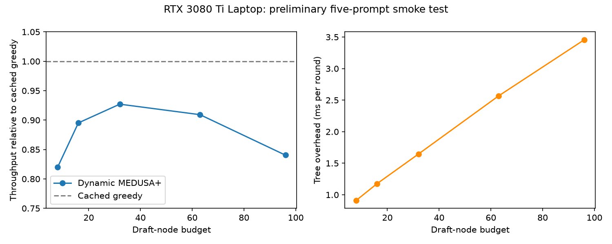

# Alex's validation results

Completed on 2026-10-31 on an NVIDIA RTX 3080 Ti Laptop GPU (16 GiB), Windows,
Python 3.11, PyTorch 2.2.2+cu118, transformers 4.36.2, and bitsandbytes 0.43.3.
The model occupies approximately 5.03 GiB of GPU tensor memory. These are local
validation and preliminary timing results; they are not the final T4 experiments.

## Correctness

- 36 automated tests passed, including exhaustive small-tree optimality, all five
  budgets, ancestor closure, score checks, real upstream buffer loading, token
  limits, first-EOS behavior, cached-baseline forward counts, exact output length
  comparison, and prompt-level bootstrap behavior.
- All five notebook cell-11 prompts reproduced official Medusa token IDs and both
  raw and effective per-round acceptance lengths at a 64-new-token limit.
- The acceptance sequences also match those saved in the notebook: 232 tokens
  across 93 rounds, or 2.4946 tokens per verification round.
- Cached greedy, uncached greedy, and static Medusa outputs agreed on all five
  notebook prompts. Loaded prediction-head tensors matched the trained checkpoint.
- The synthetic pipeline completed all 25 method-budget combinations. Its CSV and
  plot are explicitly labeled synthetic and contain no measured speedups.

## Preliminary laptop timing

Each budget used one warmup prompt and five measured prompts, with a maximum of
64 new tokens. These are a small smoke-test prompt set, not MT-Bench. Methods were
randomly ordered within each prompt. Throughput is total tokens / total seconds.
The comparison is against a separately measured cached-greedy baseline for that
budget's run. The same five prompts are reused across budgets.

| Dynamic MEDUSA+ budget | Tokens / second | Relative throughput | Accepted tokens / round | Tree overhead ms / round | Exact output matches |
|---|---:|---:|---:|---:|---:|
| 8 | 19.58 | 0.820x | 2.035 | 0.913 | 4/5 |
| 16 | 21.19 | 0.895x | 2.255 | 1.176 | 5/5 |
| 32 | 22.23 | 0.927x | 2.447 | 1.645 | 5/5 |
| 63 | 21.63 | 0.909x | 2.556 | 2.567 | 5/5 |
| 96 | 20.17 | 0.840x | 2.584 | 3.454 | 4/5 |

Cached greedy measured approximately 23.67-24.00 tokens/second across runs.
The native 63-node Medusa tree measured 21.26-21.50 tokens/second, with exact
agreement on every prompt in every run. Its native budget remains 63 even when
listed in a benchmark file for another dynamic budget.

Tree overhead is a separate synchronized profile of the first measured prompt,
not an average over all five prompts. Instrumented profile timings are excluded
from throughput calculations. The finite sample and laptop hardware limit what
can be concluded: none of these measured policies beat cached greedy here.
Higher acceptance alone did not establish an end-to-end speedup.

## Dynamic output differences

At budgets 8 and 96, the story prompt first differs at generated-token index 50
(zero-based), after the common prefix ending in "couldn't find her car key".
Cached greedy chooses a period; the dynamic run chooses "anywhere".

The cached logits for period and anywhere are 23.03125 and 23.0 (gap 0.03125).
The dynamic verification logits are 23.015625 and 23.015625 (an exact tie).
This is direct evidence of a numerical tie at the divergence. The results retain
these mismatches; neither outputs nor model settings were altered to hide them.
See the two `dynamic_divergence_B*.json` files for IDs, prefixes, and logits.

## Remaining project work

Lucia's real calibration/evaluation traces and Ada's fitted models and fixed trees
are still needed for the final matched-budget comparisons. Run the validated
harness on the designated T4 with the same pinned collection settings and real
MT-Bench first-turn prompts for the final speed table. Report conclusions should
be updated from those experiments rather than extrapolated from this smoke test.
